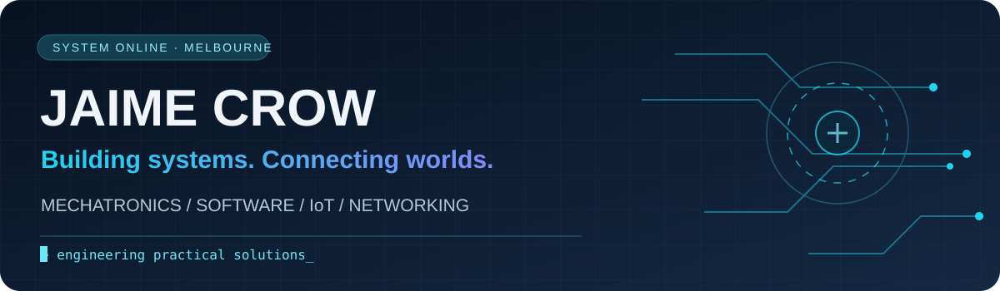

### Mechatronics Engineer · IT & Networking · Software & IoT

**Melbourne, Australia** · Building practical solutions across physical and digital systems

---

## `01 // SYSTEM PROFILE`

I'm a mechatronics engineer based in Melbourne, combining hands-on technical troubleshooting with software development, networking and automation. I enjoy turning operational problems into testable systems, from mobile workflows to computer vision and connected devices.

**Interested in:** IT Support · Field Service · Network Technician · Automation · IoT · Technical Software Roles

## `02 // FEATURED MISSIONS`

<table>
<tr><td width="50%" valign="top">

### 🏨 [HOTELFLOW](https://github.com/JotaC95/HotelApp)

**Hotel operations and mobile workflows**

A prototype for housekeeping, room status, scheduling and operational coordination.

  

**Status:** Work in progress

</td><td width="50%" valign="top">

### 🐄 [CATTLE VIRTUAL FENCE](https://github.com/JotaC95/cattle_virtual_fence)

**Computer vision and connected systems**

Experimental video backend, zone management and mobile integration for livestock monitoring.

  

**Status:** Research prototype; not a validated containment system

</td></tr>
<tr><td width="50%" valign="top">

### 📡 [NETWORK DEVICE DETECTOR](https://github.com/JotaC95/netowrkDeviceDetector)

**Network discovery and diagnostics**

Python ARP discovery with IP/MAC reporting and timestamped CSV exports.

 

**Status:** Learning and diagnostic tool

</td><td width="50%" valign="top">

### 🏗️ [OSPINING WEB](https://github.com/JotaC95/ospining-web)

**3D engineering visualization**

A conceptual steel-building assembly experience with scroll-driven 3D interaction.

 

**Status:** Interactive prototype; not an approved structural design

</td></tr>
</table>

## `03 // TECHNICAL SYSTEMS`

**Development**

    

**Infrastructure & data**

   

**Hardware, vision & interactive systems**

   

## `04 // DEVELOPMENT SIGNAL`

Live third-party stats may occasionally be unavailable; GitHub itself remains the source of truth for activity. Private contributions and repository visibility can affect displayed totals.

## `05 // CONNECT`

[**LinkedIn**](https://www.linkedin.com/in/jaimejosecrow/) · [**Repositories**](https://github.com/JotaC95?tab=repositories)

Some repositories are exploratory prototypes. Project-specific documentation describes scope, limitations and verification status. A final portfolio website will be linked when ready.
